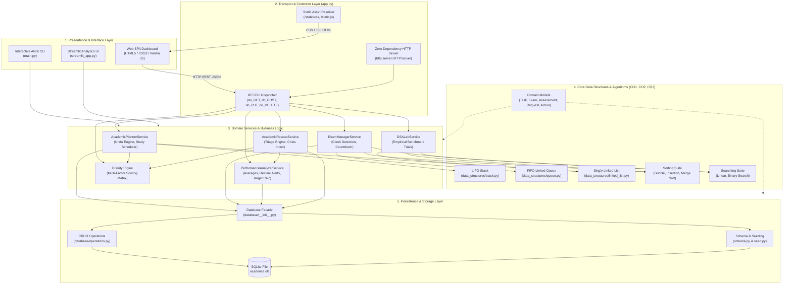
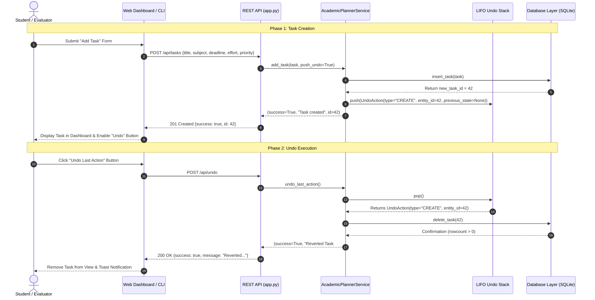

# Acadence - System Architecture & Technical Design

## 1. System Overview & Philosophy

**Acadence** is a multi-tier academic productivity, schedule conflict detection, and examination planning system. It is designed to demonstrate computer science and Data Structures & Algorithms (DSA) coursework concepts—specifically **CO1** (Linear Data Structures: Stack & Queue), **CO2** (Linked Lists & Sequential Search), and **CO3** (Divide-and-Conquer Algorithms & Asymptotic Complexity Analysis)—while delivering a zero-external-dependency, production-grade application.

The core architecture follows a **Decoupled 4-Tier Layered Design** ensuring that domain data structures, business logic, persistence, and presentation interfaces remain strictly separated.

---

## 2. Layered Architecture Diagram

---

## 3. Tier-by-Tier Architectural Breakdown

### Tier 1: Presentation & User Interfaces
Acadence provides three concurrent, non-conflicting user interfaces:
1. **Single-Page Application (SPA)**: Handcrafted with semantic HTML5, pure CSS custom properties (`--bg`, `--surface`, `--primary`), and vanilla JavaScript (`static/js/app.js`). Zero frontend framework dependencies (`React`, `Vue`, `Tailwind` not required).
2. **Interactive Terminal CLI (`main.py`)**: Designed for headless servers, examiners, and terminal power-users. Features ANSI color escapes (`\033[96m`), ASCII tabular alignment, and guided workflow menus.
3. **Streamlit Analytics Dashboard (`streamlit_app.py`)**: Optional visualization layer using Streamlit and Plotly for graphical grade trend curves and interactive radar charts.

### Tier 2: Transport & API Routing (`app.py`)
* Built directly on Python standard library `http.server.HTTPServer` and `BaseHTTPRequestHandler`.
* Manages HTTP lifecycle:
  * Static file delivery with MIME-type resolution (`text/html`, `text/css`, `application/javascript`).
  * REST API routing with method dispatching (`do_GET`, `do_POST`, `do_PUT`, `do_DELETE`).
  * Cross-Origin Resource Sharing (CORS) headers and JSON serialization.

### Tier 3: Application Services (`services/`)
Encapsulates all domain business logic and algorithmic orchestration:
* **`PriorityEngine`**: Evaluates task urgency, user priority, academic subject vulnerability, and estimated effort to output explainable priority scores.
* **`AcademicRescueService`**: Calculates the systemic academic **Crisis Index** (0 to 100) and curates emergency triage recommendations.
* **`AcademicPlannerService`**: Bridges persistent SQLite storage with the in-memory **LIFO Stack** to provide instant $\mathcal{O}(1)$ rollback for modifications.
* **`ExamManagerService`**: Orchestrates examination schedules, pairwise interval clash detection ($\mathcal{O}(n^2)$), and the **FIFO Service Queue**.
* **`PerformanceAnalyzerService`**: Computes weighted cumulative grade averages, multi-assessment trajectory trends, decline detection, and target exam mark reverse-engineering.
* **`DSALabService`**: Executes controlled empirical benchmarking on searching, sorting, and storage data structures across datasets up to $N = 5,000$.

### Tier 4: Core Data Structures & Algorithms (`data_structures/`, `algorithms/`)
Hand-crafted fundamental computer science structures implemented from first principles:
* **Custom Node (`Node`)**: Data reference and dynamic pointer chaining.
* **Singly Linked List (`SinglyLinkedList`)**: Dynamic node allocation with $\mathcal{O}(1)$ head insertion and sequential traversal.
* **LIFO Stack (`Stack`)**: Dynamic array-backed stack with capacity boundaries, enforcing strict Last-In, First-Out order.
* **FIFO Queue (`Queue`)**: Linked-node queue with dedicated `_front` and `_rear` pointers guaranteeing strict $\mathcal{O}(1)$ enqueue and dequeue operations without array shift penalties.
* **Sorting Algorithms**: Bubble Sort with early termination flag, Insertion Sort with shift counting, and recursive Merge Sort.
* **Searching Algorithms**: Sequential Linear Search on linked lists and arrays, and Divide-and-Conquer Binary Search on sorted lists.

### Tier 5: Persistence Layer (`database/`)
* **Engine**: SQLite 3 (embedded in Python standard library).
* **Connection Manager (`connection.py`)**: Configures `sqlite3.Row` factory for dictionary-like column access and maintains thread-safe file paths.
* **Schema Definition (`schema.py`)**: DDL table definitions and clean data wipe procedures.
* **Seeding Engine (`seed.py`)**: Generates realistic academic records using relative timestamps (`now + timedelta(days=X)`) so demo data is consistently active.
* **Operations Layer (`operations.py`)**: Parameterized SQL queries preventing SQL injection vulnerabilities.

---

## 4. Architectural Design Patterns

| Pattern | Component | Implementation Detail |
| :--- | :--- | :--- |
| **Memento / Command** | Multi-Level Undo Engine | When a task is created, updated, or deleted, an `UndoAction` snapshot containing the previous and new states is pushed onto the `Stack`. Reverting pops the token and executes the inverse database operation. |
| **Facade Pattern** | `database/__init__.py` | Shields all services and API routes from low-level SQLite cursor mechanics, SQL queries, and connection lifecycles by exposing clean top-level functions. |
| **Strategy Pattern** | `algorithms/sorting.py` | Encapsulates multiple sorting algorithms (`bubble`, `insertion`, `merge`) behind interchangeable callable interfaces accepting common parameters (`arr`, `key_func`, `reverse`). |
| **Triage Pattern** | `AcademicRescueService` | Evaluates multi-dimensional risk signals (overdue tasks, impending deadlines, grade vulnerabilities) into a unified priority queue of actionable recommendations. |
| **Zero-Dependency Pattern** | Entire Core System | Core server, database, models, algorithms, and CLI execute purely on standard library Python, eliminating `node_modules`, `pip` dependencies, or environment conflicts during evaluation. |

---

## 5. End-to-End Sequence Diagram (Example: Task Creation & Undo)

