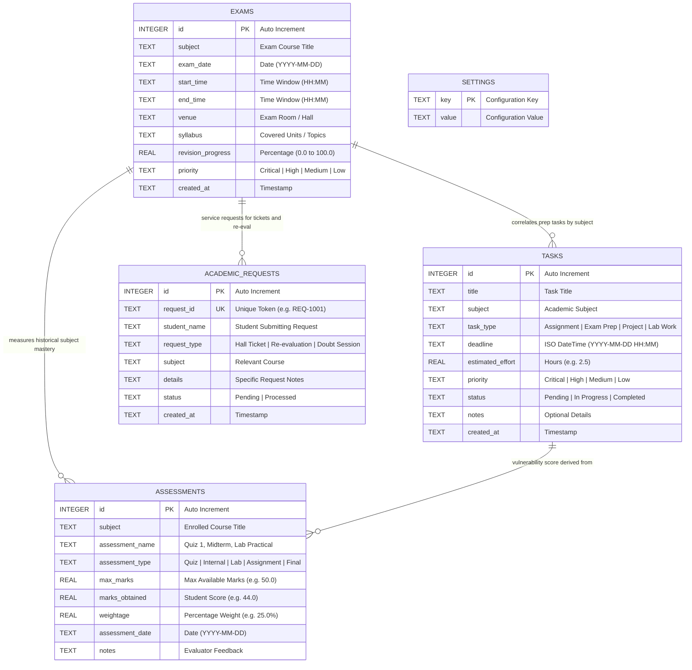
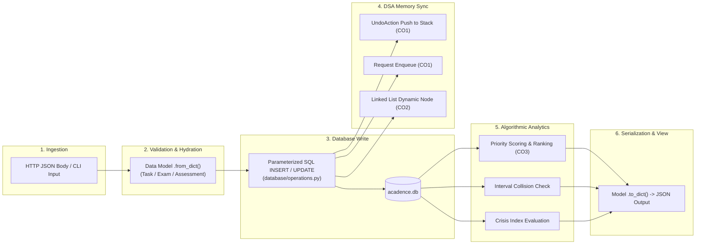

# Acadence - Database Architecture & Data Pipeline

## 1. Persistence Philosophy & Engine Selection

Acadence uses **SQLite3**, Python's native embedded relational database engine.

### Why SQLite3?
1. **Zero External Dependencies**: Embedded in Python's standard library (`import sqlite3`). Runs instantly on any evaluation machine without configuring PostgreSQL, MySQL, or Docker containers.
2. **ACID Transaction Guarantees**: Atomicity, Consistency, Isolation, and Durability ensure academic records (especially during multi-level undo operations) are never partially written.
3. **Low Latency**: Direct in-process file I/O eliminates network socket overhead for sub-millisecond query responses.
4. **Reproducible Portability**: The entire database state resides in a single file (`acadence.db`), which can be inspected, backed up, or reseeded in one operation.

---

## 2. Entity-Relationship Diagram (ERD)



---

## 3. Detailed Data DDL & Schema Specifications

### 3.1 `tasks` Table
Stores actionable academic work items evaluated by the Priority Engine and Smart Planner.

```sql
CREATE TABLE IF NOT EXISTS tasks (
    id INTEGER PRIMARY KEY AUTOINCREMENT,
    title TEXT NOT NULL,
    subject TEXT NOT NULL,
    task_type TEXT NOT NULL,
    deadline TEXT NOT NULL,
    estimated_effort REAL NOT NULL,
    priority TEXT NOT NULL,
    status TEXT NOT NULL,
    notes TEXT,
    created_at TEXT NOT NULL
);
```

* **Constraints**:
  * `task_type`: Allowed values `['Assignment', 'Exam Prep', 'Project', 'Lab Work']`.
  * `priority`: Allowed values `['Critical', 'High', 'Medium', 'Low']`.
  * `status`: Allowed values `['Pending', 'In Progress', 'Completed']`.
  * `estimated_effort`: Expressed in floating-point decimal hours ($\ge 0.1$).

### 3.2 `exams` Table
Stores scheduled examinations evaluated by the Conflict Detector and Countdown Timer.

```sql
CREATE TABLE IF NOT EXISTS exams (
    id INTEGER PRIMARY KEY AUTOINCREMENT,
    subject TEXT NOT NULL,
    exam_date TEXT NOT NULL,
    start_time TEXT NOT NULL,
    end_time TEXT NOT NULL,
    venue TEXT NOT NULL,
    syllabus TEXT,
    revision_progress REAL NOT NULL,
    priority TEXT NOT NULL,
    created_at TEXT NOT NULL
);
```

* **Constraints**:
  * `exam_date`: Format `YYYY-MM-DD`.
  * `start_time` / `end_time`: 24-hour format `HH:MM`.
  * `revision_progress`: Real number bounded between $0.0\%$ and $100.0\%$.

### 3.3 `assessments` Table
Stores continuous internal evaluations, quizzes, and lab scores.

```sql
CREATE TABLE IF NOT EXISTS assessments (
    id INTEGER PRIMARY KEY AUTOINCREMENT,
    subject TEXT NOT NULL,
    assessment_name TEXT NOT NULL,
    assessment_type TEXT NOT NULL,
    max_marks REAL NOT NULL,
    marks_obtained REAL NOT NULL,
    weightage REAL NOT NULL,
    assessment_date TEXT NOT NULL,
    notes TEXT
);
```

* **Derived Calculations**:
  $$\text{Percentage} = \text{round}\left(\frac{\text{marks\_obtained}}{\text{max\_marks}} \times 100.0, \; 2\right)$$

### 3.4 `academic_requests` Table
Powers the custom FIFO Queue for student academic operations.

```sql
CREATE TABLE IF NOT EXISTS academic_requests (
    id INTEGER PRIMARY KEY AUTOINCREMENT,
    request_id TEXT NOT NULL UNIQUE,
    student_name TEXT NOT NULL,
    request_type TEXT NOT NULL,
    subject TEXT NOT NULL,
    details TEXT,
    status TEXT NOT NULL,
    created_at TEXT NOT NULL
);
```

### 3.5 `settings` Table
Key-value storage for application configuration.

```sql
CREATE TABLE IF NOT EXISTS settings (
    key TEXT PRIMARY KEY,
    value TEXT NOT NULL
);
```

* **Default Configuration Pairs**:
  * `warning_threshold`: `"60.0"` (Percentage below which subjects are flagged as vulnerable).
  * `target_percentage`: `"80.0"` (Student goal average).
  * `daily_study_hours`: `"3.5"` (Study time budget for daily schedule packing).
  * `theme`: `"dark"` (UI color mode).
  * `student_name`: `"Alex Chen"`.
  * `degree_program`: `"B.Tech Computer Science & Engineering (Semester 3)"`.

---

## 4. End-to-End Data Pipeline

The Acadence data pipeline governs the lifecycle of data from initial ingestion through transformation, in-memory data structure processing, and JSON serialization.



---

## 5. Dynamic Demo Seeding Engine (`database/seed.py`)

Static demo databases quickly become obsolete because hardcoded dates pass into history (e.g. all tasks show as overdue).

To ensure that Acadence is **consistently active and ready for evaluation**, `database/seed.py` dynamically anchors all demo data to the **execution timestamp**:
```python
now = datetime.now()

# Tasks
deadline_tomorrow = (now + timedelta(days=1, hours=4)).strftime("%Y-%m-%d %H:%M")
deadline_overdue  = (now - timedelta(days=1)).strftime("%Y-%m-%d %H:%M")  # Overdue demo!
deadline_nextweek = (now + timedelta(days=7)).strftime("%Y-%m-%d %H:%M")

# Exams
exam_nearest = (now + timedelta(days=4)).strftime("%Y-%m-%d")  # Generates live countdown
exam_clash_1 = (now + timedelta(days=15)).strftime("%Y-%m-%d") # Clashing date demo
exam_clash_2 = (now + timedelta(days=15)).strftime("%Y-%m-%d")
```

### Pre-Seeded Academic Scenarios
1. **Operating Systems**: 3 assessments exhibiting a **consecutive downward trajectory** (16/20 $\rightarrow$ 28.5/50 $\rightarrow$ 9.5/20), actively triggering the **Decline Detection Alert**.
2. **Data Structures & Algorithms**: Exemplary performance (90.7% average) with an imminent upcoming exam in 4 days, driving exam prep tasks.
3. **Discrete Mathematics**: Vulnerable subject (58.0% average, below the 60.0% threshold), triggering the **Academic Rescue Mode** triage engine.
4. **Schedule Clash**: Two exams intentionally set for the same date with overlapping time windows to demonstrate the algorithmic collision detector.
